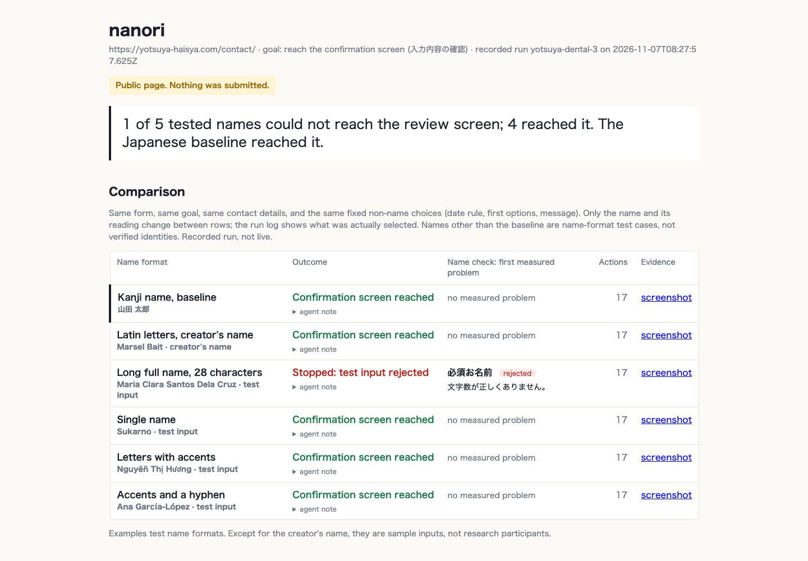

# nanori

**Your form works with your test data. Does it work with your customers' names?**

nanori is a test tool for people who build or maintain Japanese web forms. Point it at a form and a goal. It drives a real Chrome, tries to reach the goal with a kanji-name baseline, then again with name-format test cases that conventional Japanese test data can miss: Latin letters, long names with spaces, a single name with no surname, diacritics, a hyphenated surname. Where a test name is rejected, cut, or altered and the baseline was not, it reports the field, the exact input, what the field kept, the error the page showed, which published guidance the behaviour is inconsistent with, and a proposed repair. Fix a local copy, rerun, and the report shows before and after.

Built for Built with Claude: Japan 2026 (Nov 2 to 8), by a foreign resident of Tokyo whose name does not fit many Japanese forms.



Open a saved report without any API call: `runs/yotsuya-dental-3/report.html` (the public finding), `runs/yotsuya-local-before/report.html` and `runs/yotsuya-local-after/report.html` (the controlled repair on a local reproduction). The boundary probe evidence is in `runs/yotsuya-dental-1/diag/`.

## What it found on a real form

A public dental reservation form in Tokyo (`runs/yotsuya-dental-*`): the Japanese baseline and four of five test names reach the confirmation screen. The 28-character test name "Maria Clara Santos Dela Cruz" is rejected with 「文字数が正しくありません。」 (character count incorrect). The limit is not in the page source, so nanori measured it: with every other field identical, 20 characters are accepted and 21 are rejected (`runs/yotsuya-dental-1/diag/`). The server implementation was not inspected. A labelled local reproduction of that form, repaired by raising the limit (the required check is kept), passes all six cases on rerun. The live site is unchanged.

Across a 32-form sample of public Tokyo forms (the headline site is one of them), a model-free probe (`nanori scan`) flagged a handful of further observations pending review (a review screen printing diacritics as HTML entities, a hiragana field rejecting a long-vowel mark, a parent-name field converting Latin letters to full width and capping at five characters). Those are observations, not proven exclusions; see `runs/scan-tokyo-1/scan.html` for the honest categories.

## Why name handling matters

Documented context, not nanori test results:

- PayPay states that bank-account linking can fail when the registered name differs from identity-verification information, and that unnecessary spaces can stop the next button from working. https://paypay.ne.jp/help/c0147/
- PayPay's identity verification has special instructions for middle names and single names (middle names in the given-name box, single names split across two boxes). A supported path exists, but it has to be found. https://paypay.ne.jp/help/c0422/
- PayPay Card tells applicants with long names to omit middle names or trailing parts to fit ten characters per name field. https://www.paypay-card.co.jp/service/004549.html
- GovTech Tokyo's Input Form Guidance ver 1.1 (March 2026), page 27, asks for one full-name field that fits middle and compound names, acceptance of the scripts people write their names in, spaces allowed, and a sufficient maximum length "because foreign names need more characters". It is guidance for Tokyo Metropolitan Government forms, not a law. https://www.digitalservice.metro.tokyo.lg.jp/documents/d/digitalservice/inputform_guidance_v11

4,281,026 foreign residents lived in Japan as of June 2026 ([Immigration Services Agency](https://www.moj.go.jp/isa/publications/press/13_00070.html)). That is context for who meets these fields, not a count of people whose names fail.

## Before you run it

- Node 20 or newer, Google Chrome installed (Playwright drives the real Chrome channel), an Anthropic API key. Runs make paid API calls: roughly 10 to 20 model calls per name case for navigation (Claude Sonnet) plus one diagnosis call (Claude Opus).
- Data flow: the browser runs on your machine, but each step sends a screenshot and the page's visible text and element list to the Claude API, and the diagnosis step sends the measured facts. Run artifacts (screenshots, report.json, report.html) are saved locally under `runs/`. Nothing is uploaded anywhere else.
- Safety: nanori is built to stop at the review screen. Known final actions (送信, 確定, 申込, 予約する, Send, Submit, Register, Book now, Pay, and their accessible labels) are blocked in code (`src/guard.ts`, tested). That is a word list plus accessible-name matching, not a proof: on an unfamiliar site a control labelled "Next" could still submit, so treat the first run on any new site as something to watch, and prefer forms you own. The demonstrated runs did not complete a booking; the send button was never clicked.

## Quick start on the bundled fixture (recommended first run)

```bash
npm install
npx playwright install chrome
cp .env.example .env        # put your ANTHROPIC_API_KEY in .env (gitignored)
npm run build
```

Terminal 1, the local test form (a clinic reservation form with three deliberate name rules):

```bash
npm run fixture
```

Terminal 2, nanori:

```bash
node dist/cli.js run http://localhost:4310/ "reach the reservation review screen"
```

Then open the path it prints (`runs/<id>/report.html`). Expect two names cut by a 10-character limit, one katakana reading rejected for its space, and one single-name case stopped by a required given-name field.

## Running on other forms

```bash
# Full run: baseline + name cases, Claude drives the browser, report in runs/<id>/report.html
node dist/cli.js run https://example.jp/reserve "reach the confirmation screen"

# Only some cases, visible browser, higher step budget
node dist/cli.js run <url> "<goal>" --cases long-name-spaces,single-name --max-steps 40

# Rerun a saved run against a repaired local copy. The target is explicit on purpose.
node dist/cli.js rerun <run-id> --target http://localhost:4313/

# Probe many forms' name fields with no model in the loop (nothing submitted)
node dist/cli.js scan scan/tokyo-forms.txt --headless

# List the name-format test cases
node dist/cli.js cases
```

## How a run works

1. Baseline: a Japanese name (kanji with its reading), Tokyo address, Japanese mobile, plain email. Claude (Sonnet) reads each page as an accessibility snapshot plus a screenshot, returns one action at a time through a strict `act` tool, and stops at the goal screen. It is built to stop at the review screen; known final actions are blocked in code (see Before you run it), and uncertain flows stop for review.
2. Name cases: same form, same contact details, same fixed non-name choices. Only the name and its reading change. Reading fields get the script they ask for (hiragana for ふりがな, katakana for フリガナ); nanori never substitutes the other script to get past an error.
3. Measurement is code (`src/checks`, unit-tested): after every fill, the field's retained value, native validation message, aria-invalid and visible error text; after a failed confirm click, every invalid field re-read by name/id; at the goal screen, whether each typed value is shown in full, cut, HTML-escaped, or missing. Errors already on screen before a fill are treated as stale.
4. Diagnosis: Claude (Opus) writes each finding from those measured facts only, with the Tokyo guidance text loaded from the `jp-form-checks` Skill, as structured output. Four classes: site defect supported by evidence, agent limitation, no observed issue, inconclusive. Every finding is marked "proposed, not yet reviewed".
5. Report: `report.html` (verdict, comparison, selected finding with paired screenshots, before/after when it is a rerun, collapsed action log) and `report.json`.

Run outcomes are: reached the review screen (verified: typed values shown on it), stopped before it (a measured rejection), not determined (step budget, no progress, or a safe stop that could not be verified). "Reached with a workaround" exists as a label but nanori does not attempt alternate entry paths yet; where a page documents one, the finding says so.

## What nanori will not claim

- No national failure rate. The scan is our sample, probe only, with its uncounted categories listed.
- Guidance, not law: "inconsistent with the guidance".
- "Reached the confirmation screen", never "completed a booking". Nothing is submitted.
- A required reading field is not a defect. A rejected reading is a defect only in the script the field asked for, with no documented alternative.
- Names in the battery are name-format test cases, not verified legal identities. A long-name limit affects people of any nationality.
- A repair verified on a local reproduction verifies the reproduction, not the live site.

## How Claude was used

Everything in this repo was written with Claude Code during the event. `CLAUDE_USAGE.md` is the log, kept as it happened. In the product: Claude Sonnet drives the browser; Claude Opus diagnoses and proposes repairs; the `jp-form-checks` Skill carries the check semantics and the guidance text into diagnosis; a PostToolUse hook (`.claude/settings.json`, `scripts/rerun-on-edit.sh`) reruns the saved run when a file under `local/` is edited, with path filter, debounce and recursion guard. Measurement never depends on a model.

## Layout

```
src/agent/      browser loop (loop.ts) and page snapshot/observation helpers (page.ts)
src/checks/     pure measurement functions, tested
src/battery.ts  baseline identity, name-format test cases, fixed scenario
src/diagnose.ts Opus writes findings from measured facts
src/report/     HTML report
src/scan.ts     model-free name-field probe across many forms
src/verdict.ts  the one honest sentence at the top of a report
fixtures/       local clinic form with deliberate name rules
local/          labelled local reproductions (before / repaired)
runs/           saved runs: screenshots, report.html, report.json (gitignored except examples)
scripts/        boundary probe, rerender, hook
.claude/skills/jp-form-checks/SKILL.md
```

## Limits and future work

- One site at a time, sequential cases. Parallel subagents were not needed for the demo and were left out.
- The review-screen check matches a typed name value against any name-labelled review row. It does not yet bind each input to its own row, so a name and a reading swapped between the name and reading rows would both still count as shown. The headline evidence is unaffected (its rows hold the right values), but no general row-specific preservation guarantee is claimed.
- The scan (`nanori scan`) is a probe for forms you have reason to test; it is not an onboarding path. Prefer your own forms or the fixture first.
- The scan stalls on forms whose other required fields it cannot fill (dates, consent); those are reported as incomplete, not as results.
- Provider-specific name rules (payment and identity verification flows) and downstream name preservation are future work, to be tested only in an authorised provider environment.
- Alternate entry paths (documented workarounds) are reported, not attempted.

MIT.
